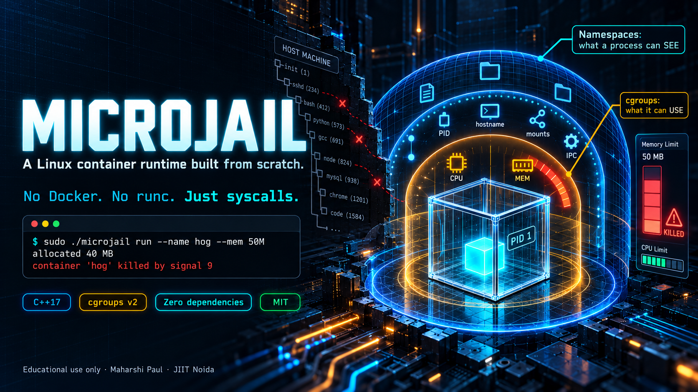
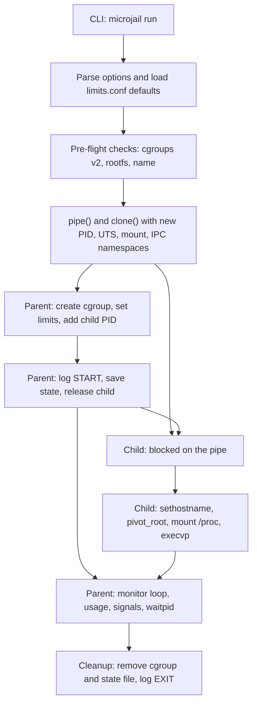

<p align="center">
  
</p>


# MicroJail

<p align="center">
  
  
  <a href="./LICENSE"></a>
  
</p>

**A Linux container runtime built from scratch: no Docker, no runc, no container library.** MicroJail uses raw kernel primitives (namespaces, `pivot_root`, cgroups v2) to run a process in its own hostname, process tree, mount table and root filesystem, under hard CPU and memory limits. Launch, list and stop containers from a small command-line tool, and watch every lifecycle event land in a log.

> [!WARNING]
> Educational use only. MicroJail is a learning tool, not a security boundary. See [Security Notice & Limitations](#security-notice--limitations).

Built by [Maharshi-Paul](https://github.com/Maharshi-Paul) · Unix Programming Lab (24B15CS214), Jaypee Institute of Information Technology, Noida

---

## Table of Contents

- [Quick Start](#quick-start)
- [Sample Output](#sample-output)
- [Problem](#problem)
- [Solution](#solution)
- [Kernel Primitives Used](#kernel-primitives-used)
- [How a Container Starts](#how-a-container-starts)
- [Project Architecture](#project-architecture)
- [Installation & Setup](#installation--setup)
- [Usage](#usage)
  - [Run a Container](#run-a-container)
  - [List and Stop Containers](#list-and-stop-containers)
  - [Command-Line Reference](#command-line-reference)
- [Configuration](#configuration)
- [How It Works, Isolation by Isolation](#how-it-works-isolation-by-isolation)
- [Running Tests](#running-tests)
- [Measured Results](#measured-results)
- [Design Decisions](#design-decisions)
- [Security Notice & Limitations](#security-notice--limitations)
- [Roadmap](#roadmap)
- [References](#references)
- [Citation](#citation)
- [License](#license)

---

## Quick Start

```bash
# 1. Clone the repository
git clone https://github.com/Maharshi-Paul/microjail.git
cd microjail

# 2. Build (needs g++, make; see Installation & Setup)
make

# 3. Download a minimal Alpine Linux root filesystem
./scripts/fetch_rootfs.sh

# 4. Start an isolated shell
sudo ./microjail run --name demo --hostname jail ./rootfs /bin/sh
```

Inside the container, `hostname` prints `jail`, `echo $$` prints `1`, and `ls /` shows only Alpine's folders. Type `exit` to leave.

Want to see the limits work? Install the test programs and try the memory hog:

```bash
./scripts/install_test_programs.sh
sudo ./microjail run --name hog --mem 50M ./rootfs /usr/local/bin/memhog
```

<!--
TODO: Once a terminal recording is captured, restore a "Demo" section (and its Table of
Contents entry) with an asciinema or GIF embed:

- assets/demo.gif: isolation checks followed by the memory hog being killed
-->

---

## Sample Output

An interactive session (the host is Ubuntu, the container is Alpine):

```console
$ sudo ./microjail run --name box1 --hostname mybox ./rootfs /bin/sh
/ # hostname
mybox
/ # echo $$
1
/ # cat /etc/os-release | head -2
NAME="Alpine Linux"
ID=alpine
/ # ls /
bin   dev   etc   home  lib   media mnt   opt   proc  root  run   sbin  srv   sys   tmp   usr   var
/ # exit
container 'box1' exited with code 0
```

A memory hog under a 50 MB limit is killed by the kernel, and the event is logged:

```console
$ sudo ./microjail run --name hog --mem 50M ./rootfs /usr/local/bin/memhog
allocated 10 MB
allocated 20 MB
allocated 30 MB
allocated 40 MB
container 'hog' killed by signal 9

$ tail -4 logs/microjail.log
2026-10-25 19:56:34 [START] hog pid=4277 mem=50M cpu=50% rootfs=./rootfs
2026-10-25 19:56:35 [USAGE] hog peak_mem=51200KB
2026-10-25 19:56:35 [OOM] hog killed by memory limit, oom_kill=1
2026-10-25 19:56:35 [EXIT] hog killed by signal 9
```

`list` and `stop` work from a second terminal (example output):

```console
$ sudo ./microjail list
NAME         PID      MEM      CPU%   STARTED   ROOTFS
box1         4962     100M     30     15:02:11  ./rootfs

$ sudo ./microjail stop box1
stopping 'box1' (pid 4962)...
stopped
```

---

## Problem

On a normal Linux system, every process shares the same view of the machine:

1. **The same process table and hostname.** A process can see (and signal) its neighbours.
2. **The same filesystem.** By default, any process can reach any file its user is allowed to read.
3. **The same pool of resources.** One runaway process can consume all the CPU or memory and starve everything else.

Tools like Docker solve this with containers, but they hide the mechanism behind a single `docker run`. It is hard to learn how isolation and resource control actually work at the operating-system level when the kernel interface is buried inside a large runtime.

---

## Solution

MicroJail removes the abstraction. It is a small, readable runtime that wires the kernel's own isolation features together:

```
[CLI] ──> [Pre-flight checks] ──> [clone() + namespaces] ──> [cgroup limits] ──> [pivot_root + /proc] ──> [execvp] ──> [Monitor & Cleanup]
```

1. **Isolate what the process can see.** `clone()` creates the child in new PID, UTS, mount and IPC namespaces, so it gets its own hostname, its own process tree (where it is PID 1), its own mount table and its own IPC objects.

2. **Confine what the process can reach.** `pivot_root` swaps the container's root for a minimal Alpine Linux directory and unmounts the old root, so host paths are gone from the container's view. (Plain `chroot` is kept only as a fallback.)

3. **Limit what the process can use.** A cgroups v2 group per container enforces a hard memory limit and a CPU quota:

   $$\text{CPU share} = \frac{\text{quota}}{\text{period}} = \frac{50000}{100000} = 50\%\ \text{of one core}$$

4. **Manage the lifecycle.** A supervisor loop tracks each container, logs start, usage and exit events, and cleans up the cgroup and state file however the container ends, including on Ctrl+C.

> **Terminology.** A *container* here is not a virtual machine. It is an ordinary process on the host kernel that has been given a restricted view of the system and a restricted budget of resources.

---

## Kernel Primitives Used

**Only Linux system calls and the C++ standard library. No container runtime, no third-party libraries.**

| Component | Operation | Kernel interface |
|---|---|---|
| Process creation | Create the child and its namespaces atomically | `clone()` with `CLONE_NEWPID \| CLONE_NEWUTS \| CLONE_NEWNS \| CLONE_NEWIPC` |
| Hostname | Per-container hostname | `sethostname()` |
| Mount isolation | Stop mount events leaking to the host | `mount(MS_REC \| MS_PRIVATE)` |
| Root filesystem | Swap the root, drop the old one | `mount(MS_BIND)`, `pivot_root()`, `umount2(MNT_DETACH)` |
| Process view | A `/proc` that shows only the container | `mount("proc")` |
| Resource limits | Memory and CPU caps | cgroups v2 files: `memory.max`, `memory.swap.max`, `cpu.max`, `cgroup.procs` |
| Startup ordering | Child waits until it is inside its cgroup | `pipe2(O_CLOEXEC)`, `read()`, `write()` |
| Supervision | Wait, poll usage, handle Ctrl+C | `waitpid(WNOHANG)`, `sigaction()`, `kill()` |
| Environment check | Detect cgroups v2 | `statfs()` (`CGROUP2_SUPER_MAGIC`) |

There is no daemon, no network traffic and no external download at runtime (the Alpine rootfs is fetched once, at setup).

---

## How a Container Starts

<details>
<summary><strong>Show the startup sequence (click to expand)</strong></summary>

### Sequence



### Why the child waits on a pipe

The parent must put the child into its cgroup **before** the child runs any user code. If it didn't, the container could allocate memory or burn CPU for a few milliseconds outside its limits. So:

1. The parent creates a pipe and calls `clone()`.
2. The child closes its copy of the write end (so it cannot hang if the parent dies) and blocks on `read()`.
3. The parent creates the cgroup, writes the limits, and writes the child's PID into `cgroup.procs`.
4. The parent writes one byte to the pipe. The child wakes up and continues.

### Why `pivot_root` and not `chroot`

`chroot` only changes where `/` points for path lookup. The host's filesystems stay mounted (visible in `/proc/self/mountinfo`), and a root process can escape with a known trick. `pivot_root` swaps the root *mount* itself, and then the old root is unmounted, so the host's paths no longer exist inside the container.

The sequence in `src/fs_isolation.cpp`: bind-mount the rootfs onto itself, `chdir` into it, `pivot_root(".", ".pivot_old")`, `chdir("/")`, `umount2("/.pivot_old", MNT_DETACH)`, `rmdir("/.pivot_old")`.

### cgroup files written per container

| File | Value | Meaning |
|---|---|---|
| `memory.max` | e.g. `52428800` | Hard memory limit in bytes (50 MB) |
| `memory.swap.max` | `0` | No swap, so the limit is a real wall |
| `cpu.max` | e.g. `50000 100000` | 50,000 µs of CPU per 100,000 µs period |
| `cgroup.procs` | child PID | Moves the process into the group |

</details>

---

## Project Architecture

```
microjail/
├── src/
│   ├── main.cpp               # CLI: run / list / stop, option parsing, orchestration
│   ├── namespace_setup.cpp    # clone() with namespaces, child setup
│   ├── fs_isolation.cpp       # pivot_root (chroot fallback)
│   ├── cgroup_manager.cpp     # cgroups v2: create, limits, add PID, remove
│   ├── process_monitor.cpp    # waitpid loop, usage polling, signal handling
│   ├── state.cpp              # per-container state files (for list / stop)
│   └── logger.cpp             # lifecycle event log
├── include/                   # one header per module
├── config/
│   └── limits.conf            # default memory / CPU limits
├── scripts/
│   ├── fetch_rootfs.sh        # downloads the Alpine minirootfs
│   └── install_test_programs.sh   # builds memhog / cpuhog into the rootfs
├── tests/
│   ├── test_namespaces.sh     # automatic isolation and lifecycle checks
│   ├── memhog.cpp             # allocates memory until killed
│   └── cpuhog.cpp             # burns CPU forever
├── docs/
│   ├── architecture.md        # design notes and system-call table
│   └── DEMO.md                # demo script
├── logs/                      # microjail.log (git-ignored)
├── Makefile
├── LICENSE
├── CONTRIBUTORS.md
└── README.md
```

| Module | Responsibility | Key calls |
|---|---|---|
| `main` | Parse options, run pre-flight checks, orchestrate startup and cleanup | `pipe2`, `statfs`, `stat` |
| `namespace_setup` | Create the container process in new namespaces | `clone`, `sethostname`, `mount` |
| `fs_isolation` | Make the rootfs the container's whole filesystem | `pivot_root`, `umount2`, `chroot` |
| `cgroup_manager` | Create a group, set limits, add the PID, remove it | file writes under `/sys/fs/cgroup` |
| `process_monitor` | Wait for exit, log usage and OOM kills, handle Ctrl+C | `waitpid`, `sigaction`, `kill` |
| `state` | Record running containers for `list` and `stop` | file I/O in `/var/run/microjail` |
| `logger` | Timestamped event log | file append |

For the full design, see [`docs/architecture.md`](./docs/architecture.md).

---

## Installation & Setup

MicroJail needs a real Linux kernel with **cgroups v2**. It cannot run natively on Windows or macOS, so use a Linux machine or a virtual machine (for example Ubuntu 24.04 in VirtualBox).

**Prerequisites**

| Requirement | Notes |
|---|---|
| Linux, kernel 5.x or newer | Tested on Ubuntu 24.04 (kernel 6.14) |
| cgroups v2 | Default on Ubuntu 22.04 and newer |
| `g++` with C++17, `make` | `sudo apt install build-essential` |
| `git`, `wget` | `sudo apt install git wget` |
| root access | Namespaces, mounts and cgroups need `sudo` |

**Check cgroups v2**

```bash
stat -fc %T /sys/fs/cgroup     # must print: cgroup2fs
```

**Build and prepare**

```bash
git clone https://github.com/Maharshi-Paul/microjail.git
cd microjail
make                                   # builds ./microjail
./scripts/fetch_rootfs.sh              # Alpine minirootfs into ./rootfs
./scripts/install_test_programs.sh     # optional: memhog and cpuhog for the demos
```

The root filesystem (`rootfs/`) is git-ignored, because it is large and re-downloadable.

> **Tip:** Run MicroJail from the repository root. The log file (`logs/microjail.log`) and the defaults (`config/limits.conf`) use relative paths.

---

## Usage

### Run a Container

```bash
sudo ./microjail run [--name N] [--mem 50M] [--cpu 50] [--hostname H] <rootfs> <cmd> [args...]
```

```bash
# interactive shell with custom limits
sudo ./microjail run --name box1 --mem 100M --cpu 30 --hostname mybox ./rootfs /bin/sh

# run a single command
sudo ./microjail run ./rootfs /bin/echo hello

# prove the memory limit
sudo ./microjail run --name hog --mem 50M ./rootfs /usr/local/bin/memhog
```

Options go **before** the rootfs. Everything after the rootfs is the command and its arguments.

### List and Stop Containers

Use a second terminal while a container is running:

```bash
sudo ./microjail list
sudo ./microjail stop box1
```

`stop` sends SIGTERM, waits up to 3 seconds, then sends SIGKILL. The wait is deliberate: the first process in a PID namespace is its `init`, and the kernel drops signals sent to it from outside unless it has installed a handler, so a plain `sh` or `sleep` ignores SIGTERM.

Pressing **Ctrl+C** in the `run` terminal also shuts the container down and cleans up.

### Command-Line Reference

| Option | Description |
|---|---|
| `run` | Start a container. Needs `<rootfs>` and `<cmd>`. |
| `--name N` | Container name (default `demo`). Letters, digits, `-` and `_`, up to 32 characters. Must be unique among running containers. |
| `--mem SIZE` | Memory limit (default `50M`). Accepts `K`, `M` or `G` suffixes, for example `100M`. |
| `--cpu N` | CPU limit as a percentage of one core, `1` to `100` (default `50`). |
| `--hostname H` | Hostname inside the container (default `jail`). |
| `list` | Show running containers: name, PID, memory limit, CPU limit, start time, rootfs. |
| `stop NAME` | Stop a running container. |

---

## Configuration

**Defaults** live in `config/limits.conf`. Command-line options override them.

```
mem=50M
cpu=50
```

| Setting | Default | Description |
|---|---|---|
| `mem` | `50M` | Default memory limit (`K`, `M`, `G` suffixes) |
| `cpu` | `50` | Default CPU limit, percent of one core |

**Fixed behaviour** (compile-time constants):

| Item | Value |
|---|---|
| cgroup directory | `/sys/fs/cgroup/microjail/<name>/` |
| State files | `/var/run/microjail/<name>.state` |
| Log file | `logs/microjail.log` (relative to the working directory) |
| CPU period | 100,000 µs |
| Swap | Disabled for containers (`memory.swap.max = 0`) |
| Monitor polling | Every 0.2 s; usage logged about every 5 s |
| `stop` grace period | 3 s before SIGKILL |
| Child stack | 1 MB |

**Log events**

| Event | Meaning |
|---|---|
| `START` | Container created (PID, limits, rootfs) |
| `USAGE` | Memory and CPU usage samples, and the peak memory at exit |
| `OOM` | The kernel killed a process for exceeding the memory limit |
| `INFO` | MicroJail itself received SIGINT or SIGTERM and killed the container |
| `ERROR` | Setup failed (for example, cgroup creation) |
| `EXIT` | Exit code, or the signal that killed the container |

---

## How It Works, Isolation by Isolation

| What | Mechanism | How to see it |
|---|---|---|
| **Hostname** | UTS namespace | `hostname` inside prints the container's name, and the host's is unchanged. |
| **Processes** | PID namespace | `echo $$` prints `1`, and `ps` lists only the container's processes. |
| **Filesystem** | Mount namespace + `pivot_root` | `cat /etc/os-release` says Alpine on an Ubuntu host, and `ls /` shows only the rootfs. |
| **Mount table** | Private mounts + `pivot_root` + `umount2` | `cat /proc/self/mountinfo` shows only a couple of entries, not the host's mounts. |
| **IPC** | IPC namespace | Compare `ls -l /proc/self/ns` on the host and inside: every ID is different. |
| **Memory** | cgroup `memory.max` | `memhog` is killed by SIGKILL, and `memory.events` shows `oom_kill 1`. |
| **CPU** | cgroup `cpu.max` | `cpuhog` stays near 50% of one core in `top`. |
| **Lifecycle** | State files + supervisor | `list` shows running containers, `stop` ends one, and nothing is left behind afterwards. |

Namespaces limit what a process can **see**, and cgroups limit what it can **use**. MicroJail needs both.

---

## Running Tests

```bash
sudo tests/test_namespaces.sh
```

The script runs 13 checks and prints `PASS` or `FAIL` for each. Run it from the repository root with no containers running, after `make`, `fetch_rootfs.sh` and `install_test_programs.sh`.

| # | Check |
|---|---|
| 1 | Container has its own hostname |
| 2 | Process is PID 1 inside the container |
| 3 | Container sees the Alpine rootfs |
| 4 | Host processes are not visible |
| 5 | `ipc`, `pid`, `uts` and `mnt` namespace IDs differ from the host's |
| 6 | `pivot_root` hides the host's mounts |
| 7 | Memory and CPU limits are applied (`memory.max`, `cpu.max`) |
| 8 | A memory hog is OOM-killed |
| 9 | cgroups and state files are cleaned up |
| 10 | `list` and `stop` work |
| 11 | A bad `--mem` value is rejected |
| 12 | A missing rootfs is rejected |
| 13 | A duplicate container name is rejected |

Expected final line: `== 13 passed, 0 failed ==`

---

## Measured Results

**Environment**

- **Platform:** Ubuntu 24.04.3 LTS in a VirtualBox VM, x86_64
- **Kernel:** 6.14.0-37-generic (cgroups v2)
- **Toolchain:** g++ 13.3.0, GNU Make 4.3, `-std=c++17 -Wall -Wextra`
- **Rootfs:** Alpine Linux v3.24.3 minirootfs (BusyBox 1.37.0)

**Memory limit** (`--mem 50M`, `memhog` allocating 10 MB at a time)

| Observation | Result |
|---|---|
| Last allocation printed | 40 MB |
| Outcome | Killed by SIGKILL (signal 9) |
| `memory.events` | `oom_kill 1` |
| Peak memory logged | 51,200 KB (the 50 MB limit) |
| Container shell | Survives, because only the offending process is killed |

**Static analysis:** `valgrind --leak-check=full ./microjail list` reports 0 errors.

<!--
TODO: Add a measured "pivot_root vs chroot" comparison, using:
  sudo ./microjail run --name m ./rootfs /bin/cat /proc/self/mountinfo | grep -c ' - '
Record the count with the chroot version (v0.3) and the pivot_root version (v0.4):

| Rootfs isolation | Mount entries visible inside the container |
|---|---|
| chroot (v0.3) | <N> |
| pivot_root (v0.4) | <M> |
-->

---

## Design Decisions

1. **`pivot_root` over `chroot`.** The old root is unmounted, so host paths cannot be reached, and the host's mounts disappear from `/proc/self/mountinfo`. `chroot` remains only as a fallback, with a warning.
2. **A pipe to order startup.** The child blocks until the parent has put it in its cgroup, so limits apply before any user code runs. The child closes its own copy of the write end, so it exits cleanly if the parent dies.
3. **Swap disabled per container.** With `memory.swap.max = 0`, the memory limit is a hard wall and the kernel's OOM killer fires at the limit.
4. **The parent is the supervisor.** `run` stays in the foreground and polls with `waitpid(WNOHANG)`, which makes Ctrl+C handling and cleanup simple and reliable. There is no background daemon.
5. **Plain-text state files.** `list` and `stop` are separate processes, so each running container writes a small `key=value` file. Stale files left by a crash are detected by checking whether the PID is still alive.
6. **Validated names.** A container name ends up in file paths, so only letters, digits, `-` and `_` are accepted, which blocks path tricks like `../x`.
7. **Pre-flight checks.** MicroJail verifies cgroups v2 and the rootfs before creating anything, and reports clear errors instead of failing deep inside a system call.

---

## Security Notice & Limitations

> [!WARNING]
> **EDUCATIONAL USE ONLY.**
> MicroJail demonstrates how container isolation works. It is **not** a security boundary and must not be used to run untrusted code.

### Known Limitations

- **Shared network.** There is no network namespace, so containers use the host's network stack.
- **No user namespace.** The process inside runs as real root, with the host kernel's full set of capabilities, so a determined process inside the container can do harm.
- **No seccomp or capability dropping.** System calls are not filtered.
- **No image layers.** The rootfs is a plain directory, with no OverlayFS and no image format.
- **Foreground only.** `run` blocks in your terminal, and there is no `--detach` mode.
- **Relative paths.** The log file and `config/limits.conf` are found relative to the working directory, so run from the repository root.
- **cgroups v2 only,** and tested on x86_64 Ubuntu only.
- **Static test programs.** Programs run inside the Alpine rootfs must be statically linked (or musl-based), because Alpine uses a different C library from Ubuntu.

---

## Roadmap

- Drop capabilities and set `no_new_privs`.
- Network namespace with a veth pair and NAT.
- Read-only root filesystem (a read-only bind remount).
- User namespaces for rootless containers.
- OverlayFS for layered images.
- Detached mode with a small supervisor process.

---

## References

- Linux man-pages: [`namespaces(7)`](https://man7.org/linux/man-pages/man7/namespaces.7.html), [`clone(2)`](https://man7.org/linux/man-pages/man2/clone.2.html), [`pivot_root(2)`](https://man7.org/linux/man-pages/man2/pivot_root.2.html), [`cgroups(7)`](https://man7.org/linux/man-pages/man7/cgroups.7.html).
- Linux kernel documentation: [Control Group v2](https://docs.kernel.org/admin-guide/cgroup-v2.html).
- Michael Kerrisk, *The Linux Programming Interface*, No Starch Press, 2010.
- [Alpine Linux](https://alpinelinux.org/downloads/): the minimal root filesystem used in the demos.

---

## Citation

If you use this repository in academic or educational work, you can cite it as:

```bibtex
@software{Paul_microjail_2026,
  author = {Paul, Maharshi},
  title = {{MicroJail: A Minimal Linux Container Runtime Built From Scratch}},
  url = {https://github.com/Maharshi-Paul/microjail},
  version = {1.0.0},
  year = {2026}
}
```

---

## License

This project is licensed under the MIT License. See the [LICENSE](./LICENSE) file for details. Contributors are listed in [CONTRIBUTORS.md](./CONTRIBUTORS.md).
